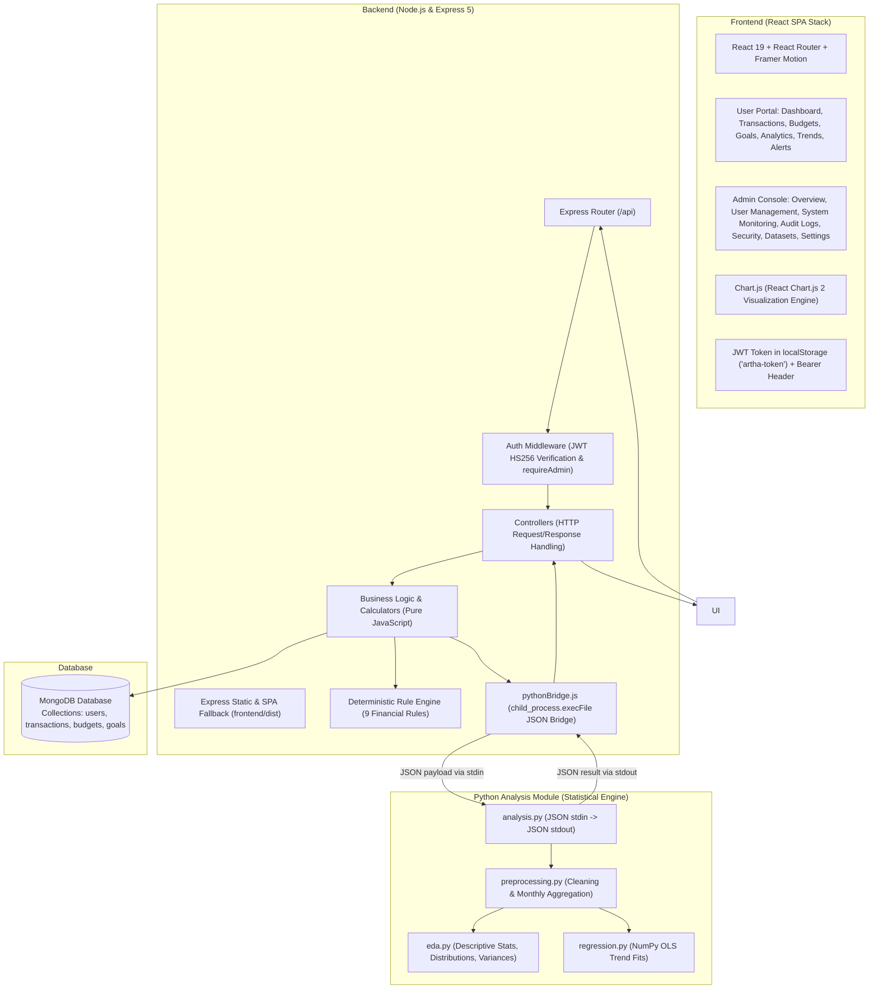

# 🏛️ ARTHA — Personal Finance Management System

> **A transparent, explainable, and full-stack personal finance web application built with React 19, Vite, Node.js, Express, MongoDB, and a statistical Python analysis engine.**

---

## 📌 Project Overview: What is Artha?

**Artha** (meaning *wealth* or *purpose* in Sanskrit) is an engineering capstone project developed based on the academic research paper:
> *Artha – Personal Finance Management System: A Research Gap Analysis and Proposed Framework* (S.P.I.T. Mumbai, August 2026).

Most modern commercial finance apps either provide simple static summaries or attempt to use opaque, black-box AI/LLM models that can hallucinate financial advice. **Artha takes a fundamentally different, academically rigorous approach:**
1. **Explainable & Deterministic:** Every alert and recommendation is generated using **pure rule-based logic** (`IF condition -> THEN recommendation -> REASON`). There is **zero AI/ML black-box hallucination**.
2. **Empirical Statistical Insights:** Trend analysis uses **NumPy Ordinary Least Squares (OLS) linear regression** to evaluate historical spending and savings behavior objectively without claiming to "predict the future".
3. **Full Privacy & Single-Tenant Scoping:** All financial records are isolated per authenticated user via JWT, with no data sharing, third-party analytics trackers, or external CDN dependencies.
4. **Strict Administrative Governance Isolation:** Dedicated Admin Console with zero-knowledge financial data isolation—administrators cannot view individual users' financial transactions, balances, budgets, or savings goals.

---

## 🏗️ System Architecture & Data Flow

Artha is architected as a modular, three-tier system with a modern compiled React SPA and an isolated statistical analysis sidecar:



### Key Architectural Characteristics:
* **Node.js serves both API and Web UI:** Express serves the static frontend files directly from the `/frontend` directory. No separate frontend dev server is needed.
* **Database Isolation:** Python **never touches the database**. Node queries MongoDB, sanitizes the data, and passes plain JSON arrays to Python.
* **Child Process Bridge:** Node executes Python via `child_process.execFile` (not `exec`), passing arguments via `stdin` and reading output via `stdout`. This eliminates command injection risks and ensures robust process sandboxing.
* **Derived Metrics Are Computed on Demand:** Budgets spent/remaining and goal completion estimates are computed by pure helper functions at read time, guaranteeing they are never out of sync.

---

## 📖 What Has Happened in the Project Up to Now? (Chronological Evolution)

The development of **Artha** progressed through systematically planned, rigorous engineering phases—transitioning from academic research specifications to an enterprise-grade, deterministic personal finance system with modern React SPA architecture:

### 🔹 Phase 1: Research Grounding & Architecture Setup
* **Academic Baseline:** Mapped the software requirements directly to the research paper *Artha – Personal Finance Management System: A Research Gap Analysis and Proposed Framework* (S.P.I.T. Mumbai, 2026).
* **Express 5 Decoupling:** Structured the backend with `app.js` separated from `server.js` to allow frictionless automated testing without port collisions.
* **Fail-Fast Environment Validation:** Engineered `backend/config/env.js` to halt the server on boot if critical security keys (such as `JWT_SECRET` with < 32 characters or invalid MongoDB URIs) are missing.
* **Database & Sandboxed Bridge:** Connected MongoDB with automated health pings (`/api/health`) and built `pythonBridge.js` to invoke Python 3 via `child_process.execFile` with JSON stdin/stdout pipes, strict timeouts, and memory constraints.
* **Automated Test Harness:** Configured Jest with in-memory MongoDB (`mongodb-memory-server`) support for zero-dependency CI/CD test runs.

### 🔹 Phase 2: User Authentication & Security Hardening
* **Stateless Token Auth:** Implemented `/api/auth/register`, `/api/auth/login`, and `/api/auth/me` with signed JWTs (HS256, 2-hour lifespan).
* **Bcrypt Hashing:** Passwords hashed with `bcrypt` (cost factor 12) with schema-level `select: false` protection so hashes are never leaked in queries.
* **Hardened Headers & Policies:** Configured `helmet` with custom Content Security Policy (CSP), CORS protection, and constant-time response simulation to prevent user enumeration attacks.
* **Role-Based Access Control (RBAC):** Integrated `role` (`user` vs `admin`) and `status` (`active` vs `suspended`) checks with immediate lockout on suspended accounts.

### 🔹 Phase 3: Core Financial Entities (Ledger, Budgets, Goals)
* **Transactions Ledger (`/api/transactions`):** Full CRUD for Income and Expenses with closed category lists (`EXPENSE_CATEGORIES`, `INCOME_CATEGORIES`). Implemented query filtering (type, category, date range, search query, amount thresholds) with pagination and precomputed totals.
* **On-Demand Budget Engine (`/api/budgets`):** Category-level spending limits across weekly, monthly, and yearly cycles. Derived metrics (spent, remaining, percentage utilized) are calculated at read time via pure functions, eliminating stale database cache issues.
* **Milestone Savings Goals (`/api/goals`):** Savings goals with target deadlines, progress percentages, required monthly savings pace, and contribution history logging (`POST /api/goals/:id/contributions`).

### 🔹 Phase 4: High-Performance Centralized Financial Dashboard
* **MongoDB `$facet` Aggregations:** Created `GET /api/dashboard` executing single-roundtrip aggregation pipelines to compute all-time and current-month totals (Income, Expenses, Net Savings), 6-month historical cash-flow series, and category breakdowns.
* **Zero-CDN Offline Charting:** Bundled local Chart.js visualizations ensuring full functionality without external CDN calls or tracking cookies.

### 🔹 Phase 5: Python Statistical Bridge & Exploratory Data Analysis (EDA)
* **Mathematical Sidecar:** Integrated Python with Pandas and NumPy (`python-analysis/preprocessing.py`, `python-analysis/eda.py`) exposed through `GET /api/analytics`.
* **Descriptive Metrics:** Calculates monthly aggregates, mean, median, standard deviation, skewness, spending distributions, and budget vs actual variances.
* **Sandboxed Execution:** Python never connects directly to MongoDB; Node.js queries the database, strips sensitive PII, and transmits plain numeric JSON arrays to Python.

### 🔹 Phase 6: Empirical Trend Fitting via NumPy OLS Linear Regression
* **NumPy Ordinary Least Squares (OLS):** Implemented in `python-analysis/regression.py` and exposed via `GET /api/regression`.
* **Objective Trend Evaluation:**
  1. *Income vs Savings Relationship:* Evaluates historical marginal propensity to save.
  2. *Chronological Spending Drift:* Measures whether expenditures have trended upwards or downwards.
  3. *Current vs Fitted Trend:* Benchmarks current monthly spend against the regression baseline.
* **Zero AI Black-Box Guarantee:** Treated strictly as statistical summaries of past financial behavior, explicitly rejecting hallucination-prone AI "predictions". Requires a minimum of 3 observations for statistical validity.

### 🔹 Phase 7: Deterministic 9-Rule Financial Alert Engine
* **Rule Engine Architecture:** Built `backend/services/ruleEngine.js` implementing 9 transparent financial rules (`CRITICAL`, `WARNING`, `INFO`).
* **Explainable Logic:** Every alert provides a mathematical condition (`IF condition -> THEN recommendation -> REASON`) covering budget breaches, negative cash flow, savings shortfalls, and expenditure spikes.

### 🔹 Phase 8: Multi-Theme Design System & UI Modernization
* **Design Tokens:** Implemented CSS custom properties (`frontend/styles/variables.css`, `frontend/styles/global.css`) supporting smooth dark/light theme switching.
* **Micro-Animations & Visual Hierarchy:** Added glassmorphic cards, responsive navigation bars, empty states, and dynamic status badges.

### 🔹 Phase 9: Administrative Governance Console & Zero-Knowledge Isolation
* **Zero-Knowledge Privacy Guarantee:** Administrators can manage accounts, inspect platform health, and audit actions, but **cannot view individual user financial records, balances, transactions, budgets, or goals**.
* **Admin Capabilities (`/api/admin/*`):**
  - Platform metric overviews and 6-month registration trends.
  - Searchable, filterable user management with account suspension and activation.
  - Privacy-preserving global aggregate analytics (category popularity counts without amounts).
  - Live system health telemetry (server uptime, memory gauges, MongoDB ping latency, Python bridge status).
  - Searchable, paginated audit logging recording all administrative actions.
  - Secure CLI bootstrap tool (`npm run admin:create`).

### 🔹 Phase 10: Realistic Synthetic Dataset Generator (`npm run seed`)
* **50 Indian Personas:** Created idempotent generator (`backend/seed/seedData.js`, `scripts/seed.js`) producing 50 diverse demo users across India with 6 months of historical transactions (1,100+ records), 200+ budgets, and 80+ goals.
* **Idempotency & Safety:** Scoped strictly to `@example.com` emails. Rerunning `npm run seed` cleans and regenerates demo data without creating duplicates, without dropping the database, and with a hard block in production (`NODE_ENV === 'production'`).

### 🔹 Phase 11: Enterprise React 19 Single Page Application (SPA) Migration
* **Complete Frontend Modernization:** Migrated the entire user and admin interfaces from legacy multi-page HTML/JS to a compiled React 19 + Vite Single Page Application (`frontend/src/`).
* **Modular Component Architecture:**
  - `UserLayout.jsx` & `AdminLayout.jsx` with distinct navigation hierarchies.
  - Protected route wrappers (`ProtectedRoute.jsx`) with role-based access checks.
  - Centralized context providers (`AuthContext.jsx`, `ThemeContext.jsx`).
  - Interactive Chart.js wrappers for all dashboard, analytics, and trend visualizations.
  - Preserved legacy HTML/CSS/JS in `frontend/pages/`, `frontend/css/`, and `frontend/js/` for complete backward compatibility.

### 🔹 Phase 12: Bespoke Branding, UI/UX Elevation & Core Alignment
* **Bespoke ARTHA Brand Identity:** Designed a custom geometric vector logo (`ArthaLogo.jsx`) representing wealth and upward progress (stylized 'A', ascending trajectory arrow, and emerald radiant node), replacing legacy placeholder icons across user navigation, admin navigation, landing, and authentication pages.
* **Card Mockup Removal & Real Wealth Focus:** Removed legacy debit/credit card mockups from the dashboard and replaced them with interactive **Top Spending Categories** progress breakdowns alongside financial health gauges.
* **Streamlined Single-Tenant Interface:** Removed "Switch to Pro" and subscription upsell elements from user navigation, maintaining a clean open-source architecture.
* **Synchronized Global Search:** Top navigation search bar is wired to submit queries on Enter and automatically synchronizes with the Transactions page via URL query parameters (`/transactions?search=<term>`), supporting both `search` and `q` backend parameter aliases.
* **Admin Dashboard Overview Fix:** Resolved summary and user metric aggregation mappings in `adminService.js` and `AdminDashboard.jsx`, accurately presenting live user metrics (52 registered users, 47 active, 5 suspended, 1,100+ transactions).
* **Logout Flow Routing:** Updated logout behavior in both `UserLayout.jsx` and `AdminLayout.jsx` to redirect directly to the front landing page (`/`) instead of the register/login screen.
* **Showcase Landing Page:** Redesigned `LandingPage.jsx` featuring dynamic radial emerald glow gradients, an interactive **Savings Elasticity Calculator** slider, live dashboard mockup preview, and platform trust metrics.

### 🔹 Phase 13: Financial Charts, Analytics & Trend Forecasting Modernization
* **Auditing & Removal of Mock Data:** Audited every visualization across User Dashboard, Analytics, Trends, and Budgets. Eliminated all hardcoded placeholder fallbacks (`85000`, `35000`, `92540`, `17000`, mock weekly curve series) in favor of live MongoDB aggregations with clean, informative empty states.
* **Unified Theme-Aware Chart Design System (`ChartTheme.js`):** Engineered a centralized design system establishing:
  - Curated financial color tokens (`CHART_PALETTE`: Blue-violet `#6366f1`, Emerald `#10b981`, Amber `#f59e0b`, Rose `#ef4444`, Cyan `#06b6d4`, Forecast Violet `#8b5cf6`).
  - Seamless dark/light theme switching with subtle gridlines and contrast-compliant typography.
  - Consistent Indian Rupee currency formatting (`formatINR`) with comma grouping and zero decimal precision.
  - Client-side Canvas PNG chart export utilities (`exportChartAsPNG`).
  - Built-in accessibility: `prefers-reduced-motion` detection disabling animations for sensitive users.
* **Overhauled User Dashboard Chart Suite:**
  - `IncomeExpenseTimelineChart.jsx`: Multi-range date selector (`7d`, `30d`, `3m`, `6m`, `12m`), Bar vs Line chart toggle, Net Savings trend overlay, and period KPI summary bar.
  - `CategorySpendingChart.jsx`: Donut chart with total spending centered in the cutout, category share percentages, small-category consolidation (<2% into "Other"), and an instant toggle to a **Ranked Horizontal Bar Chart**.
  - `CashFlowChart.jsx`: Grouped bar chart comparing inflows vs outflows with a net cash-flow overlay line.
  - `BudgetPerformanceChart.jsx`: Horizontal comparison of Budgeted vs Actual Spend vs Remaining balance, days left in cycle, and dynamic alert coloring (Green <80%, Amber 80-99%, Red >=100%).
* **Elevated Exploratory Analytics Chart Suite (`Analytics.jsx`):** Completely modernized `/analytics` to match the dashboard's design system, interactive controls, and visual polish:
  - **Expense Distribution Profile (`ExpenseDistributionChart.jsx`):** Frequency histogram with interactive switch between **Transaction Count** and **Percentage Share (%)**, skewness classification badge (Right-skewed, Left-skewed, Symmetric), average/median dispersion chips, and PNG export.
  - **Category-Wise Spending Breakdown (`CategorySpendingChart.jsx`):** Integrated center-labeled donut chart with interactive share percentages and instant toggle to **Ranked Horizontal Bars**.
  - **Bivariate Scatter Relationships (`BivariateScatterChart.jsx`):**
    - *Income vs. Expenditure:* Scatter points with toggleable OLS linear fit trendline, Pearson $r$ badge, and rich coordinate inspection.
    - *Income vs. Net Savings:* Scatter points with marginal propensity to save badge and toggleable **20% Target Savings Guide Line** ($y = 0.2x$).
  - **Budget vs. Actual Variance (`BudgetPerformanceChart.jsx`):** Integrated horizontal utilization bars with days remaining and overspend warnings.
  - **Monthly Cashflow Dynamics (`CashFlowChart.jsx`) & Savings Trajectory (`SavingsPerformanceChart.jsx`):** Replaced legacy basic lines with dual-bar cash flow dynamics and area savings trajectories compared against healthy target lines.
  - **Monthly Financial Statement Table:** Added direct **CSV Export** button (`exportMonthlyTableCSV`), surplus/deficit badges, and MoM change indicators.
* **Dedicated Financial Trends Analytical Workspace (`FinancialTrends.jsx`):** Redesigned `/trends` from a generic chart page into a comprehensive analytical workspace featuring:
  - **Section A — Monthly Financial Overview:** Cash-flow trends accompanied by auto-generated natural language narratives computed purely from live mathematical differences (e.g. *"In your latest recorded month (2026-10), your expenses increased by ₹4,200 (12%) compared with 2026-09..."*).
  - **Section B — Spending Trend Shifts:** Multi-category composition analysis automatically highlighting rising and dominant expenditure categories.
  - **Section C — Month-over-Month Shift Cards:** Compares current vs previous periods for Income, Expenses, Net Savings, and Savings Rate (reported accurately in percentage points `pp`), safely handling zero-value previous baselines without `NaN` or `Infinity`.
  - **Section D — 6 Core Financial Health Indicators:** Interactive cards for *Savings Rate*, *Essential vs Discretionary Ratio*, *Budget Adherence*, *Income-to-Expense Coverage*, *Spending Volatility (Standard Deviation)*, and *Savings Habit Continuity*—each equipped with expandable cards explaining what the metric measures, how it is calculated, and what data limitations apply.
  - **Section E — Empirical Trend Projection & 95% Prediction Interval (`FinancialTrendForecastChart.jsx`):** Renders historical spending, the OLS regression baseline, and a 3-month projection with a shaded 95% prediction interval band and an explicit assumptions/methodology notice.
* **Python Statistical Engine Calibration (`python-analysis/regression.py`):**
  - Enhanced the OLS regression module to calculate future month projections when $\ge 3$ months of data exist.
  - Implemented exact formulas for residual standard error ($s_e$) and standard error of forecast prediction ($SE_{pred}$), computing empirical 95% prediction intervals via $t_{crit} = 1.96$ ($z$-approximation).
  - Maintained complete backward compatibility with existing Jest and Pytest assertions.
* **100% Automated Test Coverage:** Achieved **387 passing automated tests** (345 Jest tests in 20 suites + 42 Pytest tests).

---

## 🔍 Key Architectural Decisions & Bug Fixes Log (Prompt Generation Reference)

This section serves as a direct reference for understanding why specific engineering decisions were made and how bugs were investigated and resolved:

| Component / Issue | Problem Observed | Root Cause Analysis | Engineering Resolution |
|---|---|---|---|
| **Hardcoded Fallbacks in Dashboard** | Legacy dashboard rendered mock statistics (`₹85,000`, `₹35,000`, `₹92,540`, `75%`) when database was empty or loading. | Fallback expressions `data?.summary?.totalIncome || 85000` were masking actual empty user accounts and misrepresenting financial reality. | Stripped all mock fallbacks in `Dashboard.jsx`. Replaced with explicit `0` values and helpful empty states explaining that transactions are required to display figures. |
| **Financial Trends Workspace** | Trends page was a duplicate of dashboard charts without deeper analytical depth or statistical context. | Visualizations lacked period comparisons, verbal explanations, indicator formulas, and forecast prediction intervals. | Completely overhauled `FinancialTrends.jsx` into a dedicated workspace featuring dynamic natural language summaries, MoM shift cards, 6 financial health indicators with expandable methodology drawers, and calibrated OLS forecasts with 95% confidence bands. |
| **Empirical Forecast & Confidence Bands** | Python regression engine computed slope and intercept but did not emit future forecast projections or prediction intervals. | Frontend was unable to display future trend projections with statistical bounds without guessing on the client side. | Enhanced `python-analysis/regression.py` to project 3 future months and compute residual standard error ($s_e$) and prediction error ($SE_{pred}$) for 95% intervals. Tested via pytest and Jest bridge. |
| **MoM Percentage Calculations** | Calculating percentage change when previous period was `0` resulted in `Infinity` or `NaN`. | Division by zero: `(cur - 0) / 0`. | Created a robust calculation helper returning `null` when `prev === 0`, rendered in the UI as "No previous baseline". Expressed savings rate differences strictly in percentage points (`pp`). |
| **Admin Overview Metrics** | Admin Dashboard cards displayed `0` for Total, Active, and Suspended Users despite 52 users existing in the database. | `backend/services/adminService.js` was returning user counts inside a nested `users: { total, active, suspended, ... }` object, while `AdminDashboard.jsx` was querying `data.summary.totalUsers`. | Updated `adminService.getDashboard()` to return both `users` and `summary` objects, and added defensive extraction fallbacks in `AdminDashboard.jsx`. Live counts immediately showed **52 total users** (47 active, 5 suspended). |
| **Global Search Bar Sync** | Typing in the topbar search input did not filter transactions on the Transactions page. | 1. `UserLayout.jsx` navigated to `/transactions?search=...`, but `Transactions.jsx` did not read `useSearchParams`.<br>2. `transactionValidation.js` only validated `q` and dropped `search` via `matchedData()`. | 1. Connected `useSearchParams` in `Transactions.jsx`.<br>2. Added `search`, `startDate`, and `endDate` query validators to `transactionValidation.js`.<br>3. Updated `transactionService.js` to accept `q \|\| search` and `from \|\| startDate`. |
| **Card Functionality Removal** | Mock debit/credit cards were present on the user dashboard. | Card mockups were generic placeholders that detracted from Artha's core purpose as an explainable ledger and financial analysis tool. | Removed `MyCardsCard.jsx` from the dashboard and replaced the layout slot with an interactive **Top Spending Categories** progress breakdown and savings gauge. |
| **"Switch to Pro" Removal** | A "Switch to Pro" upgrade prompt was present in the user navigation sidebar. | Artha is an open-source, single-tenant, privacy-preserving system with no paid tier or monetization upsells. | Removed the upgrade prompt from `UserLayout.jsx`, streamlining sidebar navigation to core functional pages. |
| **Brand Identity Overhaul** | Legacy interfaces used generic "Money T" or dollar bag icons. | Did not align with the project's identity: **ARTHA** (Sanskrit for wealth, purpose, prosperity). | Created `ArthaLogo.jsx`, a custom SVG component with an architectural 'A', an upward momentum arrow, and an emerald glowing node, integrated across all pages. |
| **Logout Redirection & Landing Entry** | Logging out previously had inconsistent redirects or allowed bypassing login directly to dashboard from the landing page. | Bypassing authentication directly to dashboard from landing buttons violates explicit credential entry and access gating. | 1. Configured `handleLogout` in both `UserLayout.jsx` and `AdminLayout.jsx` to navigate directly to the landing page (`/`) with `{ replace: true }`.<br>2. Cleared tokens unconditionally via `tokenStorage.clear()`.<br>3. Removed all direct "Go to Dashboard" and demo bypass buttons from `LandingPage.jsx`; all entry points now route strictly through `/login`. |
| **Frontend Architecture** | Static multi-page HTML required full page reloads and duplicated layout code. | Legacy vanilla architecture made state sharing between authentication and navigation clunky. | Migrated to React 19 + React Router + Vite SPA, providing instantaneous client-side transitions and Framer Motion micro-animations while maintaining legacy HTML files in `/pages`. |

---

## 🧠 The 9 Deterministic Financial Rules (No AI/ML)

Artha generates advice through **deterministic mathematical rules** rather than generative AI or probabilistic machine learning. Every alert provides an explicit reason and verifiable mathematical condition:

| Rule ID | Rule Name | Severity | Condition Trigger | Recommendation |
|---|---|---|---|---|
| `HIGH_BUDGET_UTILIZATION` | High Budget Utilization | `CRITICAL` / `WARNING` / `INFO` | Spent $\ge 100\%$ (Critical), $\ge 90\%$ (Warning), or $\ge 80\%$ (Info) of category budget | "Reduce spending in this category" / "Review your expenditure" |
| `EXPENSES_EXCEED_INCOME` | Expenses Exceed Income | `CRITICAL` | Total monthly expenses $>$ Total monthly income | "Review your monthly expenditure" |
| `SAVINGS_GOAL_SHORTFALL` | Savings Goal Shortfall | `WARNING` | Current savings $<$ Required monthly contribution for active goal | "Increase your monthly savings" |
| `CATEGORY_CONCENTRATION` | Category Concentration | `WARNING` | A single category accounts for $> 40\%$ of all expenses | "Review spending in this category" |
| `LOW_SAVINGS_RATE` | Low Savings Rate | `WARNING` | Net savings rate $< 20\%$ of total income | "Review your savings and expenditure" |
| `MONTHLY_SPENDING_SPIKE` | Monthly Spending Spike | `WARNING` | Current month spending is $> 20\%$ higher than the previous month | "Review your recent spending increase" |
| `REPEATED_CATEGORY_OVERSPENDING`| Repeated Category Overspending | `WARNING` | A category exceeds budget for $\ge 2$ consecutive months | "Review your recurring overspending" |
| `GOAL_CONTRIBUTION_GAP` | Goal Contribution Gap | `WARNING` | Actual monthly contribution $<$ Required monthly pace to hit target date | "Increase your monthly contribution" |
| `LOW_REMAINING_BUDGET` | Low Remaining Budget | `WARNING` | Remaining budget $\le 10\%$ of total limit and not yet 100% exceeded | "Limit further spending in this category" |

---

## 📁 Project Directory Structure

```text
artha-personal-finance-management/
├── backend/
│   ├── config/              # Environment validation (env.js), DB connection (db.js), CORS (cors.js)
│   ├── controllers/         # Express request handlers (auth, transactions, budgets, goals, dashboard, admin, etc.)
│   ├── middleware/          # JWT auth middleware (authenticate, requireAdmin), error handler, validation
│   ├── models/              # Mongoose schemas (User.js, Transaction.js, Budget.js, Goal.js, AuditLog.js)
│   ├── routes/              # Express API route endpoints mounted under /api
│   ├── seed/                # Idempotent synthetic dataset generator (seedData.js)
│   ├── services/            # Business logic, adminService.js, calculators, ruleEngine.js, and pythonBridge.js
│   ├── utils/               # AppError class, money formatting, predefined categories
│   ├── app.js               # Express application builder (serves React SPA & API routes)
│   └── server.js            # Server entry point (starts listener & connects DB)
├── docs/
│   ├── decisions.md         # Documented architectural decisions for project viva
│   └── paper-reconciliation.md # Traceability matrix mapping code to the research paper
├── frontend/
│   ├── src/                 # Modern React 19 Single Page Application:
│   │   ├── components/      # Common UI (ArthaLogo, MetricCard, Modal, NotificationPopover, ProtectedRoute, Skeleton, Toast) & Charts
│   │   ├── context/         # AuthContext.jsx (session & roles) and ThemeContext.jsx (dark/light)
│   │   ├── layouts/         # UserLayout.jsx (finance nav) and AdminLayout.jsx (strictly admin nav)
│   │   ├── pages/
│   │   │   ├── LandingPage.jsx      # Marketing hero, feature cards, and quick demo entry
│   │   │   ├── LoginPage.jsx        # Login with demo account autofill buttons
│   │   │   ├── RegisterPage.jsx     # User account creation with client validation
│   │   │   ├── user/                # Personal Finance: Dashboard, Transactions, Budgets, Goals, Analytics, Trends, Alerts
│   │   │   └── admin/               # Administrative: Overview, User Management, Monitoring, Audit Logs, Security, Datasets, Settings
│   │   ├── services/        # Centralized REST clients (api.js, authService.js, adminService.js, financeService.js)
│   │   ├── styles/          # Design system (variables.css, global.css, animations.css)
│   │   ├── App.jsx          # Route tree and role-based guards
│   │   └── main.jsx         # React DOM bootstrap
│   ├── css/                 # Legacy CSS preserved alongside
│   ├── js/                  # Legacy JavaScript helpers preserved alongside
│   └── pages/               # Legacy HTML pages preserved alongside
├── python-analysis/
│   ├── analysis.py          # Main CLI entry point: reads JSON from stdin, returns JSON on stdout
│   ├── preprocessing.py     # Data cleaning, type coercion, and monthly aggregation
│   ├── eda.py               # Descriptive statistics, distributions, and budget variances
│   ├── regression.py        # Ordinary Least Squares (OLS) trend line calculation via NumPy
│   ├── requirements.txt     # Python dependencies (pandas, numpy, pytest)
│   └── tests/               # Python unit tests for EDA and regression
├── scripts/
│   ├── create-admin.js      # CLI tool to bootstrap/promote administrators safely
│   ├── seed.js              # Development synthetic data generator runner
│   └── run-pytest.js        # Node runner script to invoke pytest across different OS environments
├── tests/                   # Jest automated test suite (345 unit, API, regression, and React SPA tests)
├── index.html               # Root HTML entry point for Vite bundling
├── vite.config.js           # Vite build and dev proxy configuration
├── .env.example             # Template for required environment variables
├── package.json             # Node dependencies and npm scripts
└── README.md                # Project documentation (this file)
```

---

## 🚀 Step-by-Step Setup & Quickstart Guide

### 1. Prerequisites
Ensure you have the following installed on your computer:
* **Node.js** (v18.x or later; v20/v22 recommended)
* **Python** (v3.10 or later) with `pip`
* **MongoDB** (Local Community Server running on `mongodb://127.0.0.1:27017` or a free MongoDB Atlas cloud cluster)

---

### 2. Installation

Open your terminal (or PowerShell on Windows) in the project directory:

#### Step A: Install Node Dependencies
```bash
npm install
```

#### Step B: Install Python Dependencies
```bash
pip install -r python-analysis/requirements.txt
```

#### Step C: Set Up Environment Variables
Create your local `.env` configuration file from the template:

* On **Windows (PowerShell / Command Prompt)**:
  ```powershell
  copy .env.example .env
  ```
* On **macOS / Linux**:
  ```bash
  cp .env.example .env
  ```

Open the `.env` file in your editor and configure the values:
```env
# MongoDB Connection URL
MONGODB_URI=mongodb://127.0.0.1:27017/artha

# JWT Secret (at least 32 characters long)
JWT_SECRET=your_super_secret_key_at_least_32_characters_long_123456

# Server Port
PORT=5000

# On Windows set to "python", on macOS/Linux set to "python3"
PYTHON_BIN=python
```

> 💡 **Tip to generate a secure JWT_SECRET:** Run this in your terminal:
> ```bash
> node -e "console.log(require('crypto').randomBytes(48).toString('hex'))"
> ```

---

### 3. Running the Application

#### Step A: Build the React Application (Vite)
Compile the React single-page application into production assets (`frontend/dist/`):
```bash
npm run build
```

#### Step B: Start the Server (Node.js & Express)
Start the Express server which serves the React application and mounts `/api/*` endpoints:
```bash
# Standard start
npm start

# Development mode with nodemon auto-reload
npm run dev
```

*(Optional)* If you are actively developing frontend React components with Vite Hot Module Replacement (HMR):
```bash
npm run client:dev
```
*Vite dev server starts on `http://localhost:5173` with automatic API proxying to `http://localhost:5000`.*

When the server starts successfully, your terminal will display:
```
[db] Connected to MongoDB
[server] Artha running at http://localhost:5000 (development)
[python] OK: Python 3.x.x, pandas 3.x.x, numpy 2.x.x
```

Open your browser and visit: **[http://localhost:5000](http://localhost:5000)**

---

### 4. Populating Synthetic Development Data (`npm run seed`)

To populate the development database with a rich, realistic dataset for testing dashboard charts, user filtering, registration trends, and financial calculations:

```bash
npm run seed
```

This generates **50 synthetic Indian user accounts** (`@example.com`), **1,000+ multi-month transactions**, **200+ budgets**, and **80+ savings goals**.

#### 🔒 Idempotency & Safeguards
* **Zero Duplicates:** Re-running `npm run seed` cleanly wipes and regenerates only demo accounts (`@example.com`). It will never duplicate records, drop database collections, or alter the admin account.
* **Production Shield:** The command automatically halts with an error if `NODE_ENV === 'production'`.

#### 🔑 Demo & Testing Credentials

| Account Type | Email | Password | Role | Status | Description |
|---|---|---|---|---|---|
| **Administrator** | `admin@artha.local` | `AdminPassword123` | `admin` | `active` | Direct access to `/admin` dedicated administration console and governance logs. |
| **Active Demo User** | `aarav.sharma@example.com` | `DemoUser123` | `user` | `active` | Direct access to `/dashboard` personal finance portal (transactions, budgets, goals, analytics). |
| **Active Demo User** | `priya.patel@example.com` | `DemoUser123` | `user` | `active` | Alternative demo user for cross-testing personal dashboard metrics. |
| **Suspended User** | `pooja.reddy@example.com` | `DemoUser123` | `user` | `suspended` | Suspended demo user for testing login lockout (403 Forbidden). |

*(All 50 demo accounts share the password `DemoUser123`)*

---


## 🧪 Running Automated Tests (386 Tests Passed)

Artha includes a comprehensive, verified test suite with **386 passed automated tests** (345 Jest tests across 20 suites + 41 Pytest tests) for both the Node.js backend and the Python engine:

```bash
# 1. Run Node.js backend tests (Jest - 345 tests across 20 suites)
npm test

# 2. Run Python analysis tests (Pytest - 42 tests)
npm run test:py

# 3. Run all tests in one go (387 tests total)
npm run test:all
```

*Note on Database Testing:* The backend tests use a real MongoDB connection. If `TEST_MONGODB_URI` is not specified in `.env`, the test runner automatically initializes an isolated in-memory MongoDB via `mongodb-memory-server`. All test databases are generated with an `artha_test_` prefix and dropped immediately after testing.

---

## 🔌 API Reference Summary

All protected endpoints require the header: `Authorization: Bearer <token>`

### 🔑 Authentication (`/api/auth`)
| Method | Endpoint | Access | Description |
|---|---|---|---|
| `POST` | `/api/auth/register` | Public | Register new user account (`email`, `password`, `name`) |
| `POST` | `/api/auth/login` | Public | Authenticate user and receive JWT token |
| `POST` | `/api/auth/logout` | Public | Stateless client logout (discards token) |
| `GET` | `/api/auth/me` | Protected | Fetch current logged-in user profile |

### 💳 Transactions (`/api/transactions`)
| Method | Endpoint | Access | Description |
|---|---|---|---|
| `GET` | `/api/transactions/categories` | Protected | Get list of predefined income and expense categories |
| `GET` | `/api/transactions` | Protected | List transactions with filters (`type`, `category`, `q` / `search`, `from` / `startDate`, `to` / `endDate`, `page`, `limit`) |
| `POST` | `/api/transactions` | Protected | Create transaction (`type`, `category`, `amount`, `date`, `description`) |
| `GET` | `/api/transactions/:id` | Protected | Fetch a single transaction |
| `PUT` | `/api/transactions/:id` | Protected | Update an existing transaction |
| `DELETE` | `/api/transactions/:id` | Protected | Delete a transaction |

### 📊 Budgets (`/api/budgets`)
| Method | Endpoint | Access | Description |
|---|---|---|---|
| `GET` | `/api/budgets` | Protected | Get active budgets with calculated spend, remaining, and utilization |
| `POST` | `/api/budgets` | Protected | Set category budget (`category`, `amount`, `period`) |
| `GET` | `/api/budgets/:id` | Protected | Fetch single budget details |
| `PUT` | `/api/budgets/:id` | Protected | Update budget amount or period |
| `DELETE` | `/api/budgets/:id` | Protected | Delete a budget limit |

### 🎯 Goals (`/api/goals`)
| Method | Endpoint | Access | Description |
|---|---|---|---|
| `GET` | `/api/goals` | Protected | Get goals with progress %, months to completion, and contribution gaps |
| `POST` | `/api/goals` | Protected | Create savings goal (`name`, `targetAmount`, `targetDate`, `monthlyContribution`) |
| `GET` | `/api/goals/:id` | Protected | Fetch single goal details |
| `PUT` | `/api/goals/:id` | Protected | Update goal parameters |
| `DELETE` | `/api/goals/:id` | Protected | Delete a goal |
| `POST` | `/api/goals/:id/contributions` | Protected | Record a monetary contribution to a goal |

### 📈 Analytics, Dashboard, Trends & Alerts
| Method | Endpoint | Access | Description |
|---|---|---|---|
| `GET` | `/api/dashboard` | Protected | Aggregated financial summary, 6-month trends, and category distribution |
| `GET` | `/api/analytics` | Protected | Python-calculated summary statistics, distributions, and budget variances |
| `GET` | `/api/regression` | Protected | Historical NumPy linear regression trends (income vs savings, spending drift) |
| `GET` | `/api/alerts` | Protected | Active rule-based recommendations and financial health alerts |
| `GET` | `/api/health` | Public | Live application and MongoDB connectivity health check |

### 🛡️ Administration APIs (`/api/admin`)
*Strictly restricted to authenticated users with `role: 'admin'`. Administrators cannot view individual users' financial data.*

| Method | Endpoint | Access | Description |
|---|---|---|---|
| `GET` | `/api/admin/dashboard` | Admin Only | Platform user totals, account status counts, 6-month registration trends, entity totals, and health preview |
| `GET` | `/api/admin/users/export` | Admin Only | Export authorized, non-sensitive account metadata to downloadable CSV |
| `GET` | `/api/admin/users` | Admin Only | Searchable, filterable, paginated user list (`q`, `status`, `role`, `sortBy`, `order`, `page`, `limit`) with safe metadata only |
| `GET` | `/api/admin/users/:id/history` | Admin Only | View complete moderation and account-status audit trail for a specific user |
| `PATCH` | `/api/admin/users/:id/status` | Admin Only | Update account status (`active` \| `suspended`) with reason recorded in audit log |
| `PATCH` | `/api/admin/users/:id/role` | Admin Only | Update account role (`user` \| `admin`) with safeguards against sole admin demotion |
| `GET` | `/api/admin/analytics` | Admin Only | Privacy-preserving aggregate analytics (category popularity counts without amounts, budget recurrence, goal status) |
| `GET` | `/api/admin/system-health` | Admin Only | Live telemetry diagnostics for Express server, memory usage, MongoDB ping latency, and Python engine |
| `GET` | `/api/admin/audit-logs` | Admin Only | Searchable, filterable, paginated audit records of administrative actions |
| `GET` | `/api/admin/dataset/stats` | Admin Only | Real-time counts of synthetic demo entities vs total platform ledger records |
| `POST` | `/api/admin/dataset/seed` | Admin Only | Trigger idempotent generation of synthetic Indian demonstration profiles and records |
| `DELETE` | `/api/admin/dataset/demo` | Admin Only | Safely purge demo records (`@example.com`) while guaranteeing admin immunity |

---


## 🎓 Academic Defense & Viva Highlights

When presenting or defending this project in an examination or viva:
1. **Why not use AI / LLM for recommendations?**
   * *Answer:* Generative AI models are stochastic, prone to hallucinations, and provide non-reproducible answers. In personal finance, advice must be provable, explainable, and compliant with predictable mathematical rules. Artha uses a deterministic 9-rule engine where every recommendation states the exact condition and threshold that triggered it.
2. **Why is NumPy Regression called "Trend Analysis" rather than "Machine Learning"?**
   * *Answer:* Ordinary Least Squares (OLS) is a classical statistical technique to describe historical linear relationships between variables (e.g. Month vs Spending or Income vs Savings). Artha strictly treats regression as an empirical summary of past behavior, not as an automated black-box predictor of future spending.
3. **How does Python interact safely with Node.js?**
   * *Answer:* Python is executed as an isolated child process via `child_process.execFile` with no shell involvement. Data is transferred strictly through standard input/output streams as validated JSON, preventing process escalation or command injection. Python has no database credentials.
4. **Where are calculations computed?**
   * *Answer:* Core financial metrics (budget utilization, goal progress, remaining balances) are calculated dynamically on read via pure functions. Storing derived fields in the database can lead to data synchronization bugs when transactions are edited or deleted.
5. **How does Artha maintain user privacy when administrators inspect the platform?**
   * *Answer:* The privacy boundary is architecturally enforced on the backend and API layer: Administrators are prevented from querying individual users' transactions, budgets, goals, regression outputs, or financial alerts. All financial endpoints remain strictly isolated to the caller's verified JWT identity (`{ userId: req.user._id }`). Admin endpoints only expose safe account metadata (name, email, role, status) and global, privacy-preserving aggregate metrics (e.g. transaction category counts without monetary sums or user identifiers).
6. **How does Artha prevent cross-account data leakage in notifications and alerts?**
   * *Answer:* The notification popover and alert feeds are dynamically bound to the authenticated user's JWT identity (`req.user._id`). The frontend popover fetches live anomaly evaluations directly from `/api/alerts` with zero static dummy mockups. Read and dismissed states are persisted in client storage strictly scoped per-user (`artha_read_notifications_${userId}`). Switching accounts or registering a clean new account immediately resets state and queries only that specific user's financial ledger, preventing cross-account financial leakage.

---

## 📜 License & Acknowledgments

* Developed at **Sardar Patel Institute of Technology (S.P.I.T.), Mumbai**.
* Framework reference: *Artha – Personal Finance Management System: A Research Gap Analysis and Proposed Framework* (2026).

